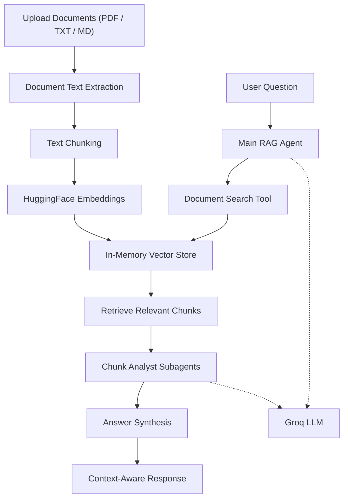

<div align="center">

# 📚 DocTalk AI

### Your documents. Clear answers.

An AI-powered document assistant that helps you explore your own knowledge. Upload PDF, TXT, or Markdown files, ask questions in natural language, and get context-aware answers grounded in your documents.

  <a href="https://doctalkai.replit.app/">
    
  </a>
  
  
  
  <!--  -->
  
</div>


---

## 🌍 Overview

**DocTalk AI** turns your documents into an interactive knowledge base. Instead of manually searching through long files, simply ask a question and let the AI retrieve relevant information and prepare an answer using the content of your uploaded documents.

The project uses a Retrieval-Augmented Generation (RAG) workflow with semantic search, local Hugging Face embeddings, and a Groq-powered agent.

## ✨ Features

- 📂 **Multi-format uploads** — Upload PDF, TXT, and Markdown (`.md`) documents.
- ⚙️ **Document processing** — Extract text, split it into manageable chunks, and index it for semantic retrieval.
- 💬 **Ask in natural language** — Query your uploaded files using everyday language.
- 🎯 **Context-aware answers** — Retrieve relevant document passages before generating an answer.
- 🤖 **Agentic workflow** — A main agent coordinates document search and chunk-analysis subagents.
- 🖥️ **Interactive chat interface** — Chat with your document collection through a Streamlit UI.
- 📚 **Session-based knowledge base** — Build an index from the files uploaded in your current session.

## 🖥️ Live Demo

**Try DocTalk AI:** https://doctalkai.replit.app/

> Note: The live demo depends on the availability of the hosted service and external APIs. Upload your documents and process them before asking questions. Responses may vary depending on document content, retrieval accuracy, and LLM availability.

## 🏗️ Architecture

DocTalk AI uses a Retrieval-Augmented Generation (RAG) workflow powered by LangChain and DeepAgents.



### How It Works

1. **Document Upload:** The user uploads PDF, TXT, or Markdown files through the Streamlit interface.
2. **Text Extraction:** PyPDF and file processing utilities extract readable text from uploaded documents.
3. **Text Chunking:** RecursiveCharacterTextSplitter divides documents into smaller, overlapping chunks.
4. **Embedding Generation:** HuggingFace's `all-MiniLM-L6-v2` model converts text chunks into vector embeddings.
5. **Vector Storage:** Embeddings are stored in an InMemoryVectorStore for semantic search.
6. **Document Retrieval:** The main agent uses the search tool to retrieve relevant chunks based on the user's question.
7. **Chunk Analysis:** DeepAgents delegates retrieved chunks to chunk-analyst subagents for focused analysis.
8. **Final Response:** The main agent combines the analysis and generates a context-aware answer using Groq.

## 🛠️ Tech Stack

| Technology | Purpose |
|---|---|
| Python | Core programming language |
| Streamlit | Interactive web interface |
| LangChain | LLM, tools, documents, and retrieval components |
| DeepAgents | Main agent and subagent orchestration |
| Groq | LLM inference |
| Hugging Face Sentence Transformers | Local text embeddings |
| InMemoryVectorStore | Semantic vector search |
| PyPDF | PDF text extraction |
| RecursiveCharacterTextSplitter | Document chunking |
| uv | Python project and dependency management |

## 📁 Project Structure

```text
DocTalkAI/
│
├── pdfs/
│   ├── climate_change.pdf       # Sample PDF document
│   └── global_warming.pdf       # Sample PDF document
│
├── src/
│   └── doctalkai/
│       ├── __init__.py          # Package initialization
│       ├── agents.py            # Main RAG agent and subagent setup
│       ├── file_reader.py       # PDF text extraction
│       ├── indexing.py          # Document chunking and vector indexing
│       ├── main.py              # Streamlit web application
│       ├── prompts.py           # Agent and subagent instructions
│       └── tools.py             # Document search tool
│
├── .gitignore                   # Files excluded from Git tracking
├── .python-version              # Python version configuration
├── pyproject.toml               # Project configuration and dependencies
├── requirements.txt             # Python dependencies
├── uv.lock                      # Locked dependency versions
│
├── README.md                    # Project documentation
└── LICENSE                      # Project license (if added)
```

*The tree illustrates the main application components. Exact asset filenames and subdirectories may vary.*

## 🚀 Getting Started

### 1. Clone the repository

```bash
git clone https://github.com/DevGoyalG/DocTalkAI.git
cd DocTalkAI
```

### 2. Create a Virtual Environment

**Windows — Command Prompt**

```bash
python -m venv venv
venv\Scripts\activate
```

**Windows — PowerShell**

```powershell
.\venv\Scripts\Activate.ps1
```

**macOS / Linux**

```bash
python3 -m venv venv
source venv/bin/activate
```

### 3. Install dependencies

```bash
uv pip install -r requirements.txt
```

### 4. Configure environment variables

Create a `.env` file in the project root and add your Groq API key:

```env
GROQ_API_KEY=your_groq_api_key
```

Get an API key from [Groq Console](https://console.groq.com/).

### 5. Run the application

```bash
uv run streamlit run src/doctalkai/main.py
```

The Streamlit app will open in your browser.

## 💬 How to Use

1. Open DocTalk AI in your browser.
2. Upload one or more PDF, TXT, or Markdown files from the sidebar.
3. Select **Build your knowledge base**.
4. Wait for the documents to be processed and indexed.
5. Ask questions in the chat input.
6. Read answers generated from the relevant document content.

## 🔐 Environment Variables

| Variable | Description |
|---|---|
| `GROQ_API_KEY` | API key used for Groq model access |

> **Note:** The embedding model `sentence-transformers/all-MiniLM-L6-v2` runs locally through the Hugging Face integration. Its first use may download the model.

## 🔐 Security and Configuration

- Store API keys and credentials in environment variables.
- Add `.env` and other sensitive files to `.gitignore`.
- Never commit API keys or secrets to GitHub.
- Validate uploaded files before processing them.
- Handle document-processing and agent errors safely.
- Consider authentication and access controls before deploying for multiple users.
- Apply suitable file-size limits and input validation.

## ⚠️ Important Limitations

- The vector store uses `InMemoryVectorStore`, so indexed documents are not permanently stored.
- Documents need to be processed again when rebuilding the knowledge base.
- Scanned PDFs may not work correctly because OCR is not currently implemented.
- The Hugging Face embedding model may need to be downloaded on first use.
- AI-generated answers depend on the quality and content of uploaded documents.
- Groq API availability, rate limits, and model responses may affect results.
- Retrieved information may be incomplete or inaccurate; verify important answers against the original documents.

DocTalk AI is a document-based AI assistant, not a guaranteed source of factual or professional advice.

## 🛣️ Future Improvements

Potential directions for extending the project include:

- [ ] Persistent vector database integration (ChromaDB / Pinecone)
- [ ] Support for Word, Excel, and PowerPoint documents
- [ ] OCR support for scanned PDFs and images
- [ ] Conversation history and memory
- [ ] User authentication and personal knowledge bases
- [ ] Source citations with page numbers
- [ ] Document preview and download functionality
- [ ] Multiple embedding model support
- [ ] Streaming AI responses
- [ ] Automated tests and CI/CD workflows
- [ ] Cloud deployment and scalability

## 🤝 Contributing

Contributions, suggestions, and bug reports are welcome!

1. Fork the repository.
2. Create a feature branch:

   ```bash
   git checkout -b feature/your-feature
   ```

3. Make your changes and test them.
4. Commit your changes:

   ```bash
   git commit -m "Add your feature"
   ```

5. Push your branch and open a Pull Request.

## 🤝 Connect with Me

<a href="https://github.com/DevGoyalG" target="_blank">
  
</a>
&nbsp;
<a href="https://www.linkedin.com/in/devgoyalg/" target="_blank">
  
</a>
&nbsp;
<a href="https://www.instagram.com/dev_goyal_g/" target="_blank">
  
</a>
&nbsp;
<a href="https://x.com/dev_goyal_g" target="_blank">
  
</a>

---

<p align="center">
  <b>Thank you for visiting! Happy Learning 🚀</b>
</p>
